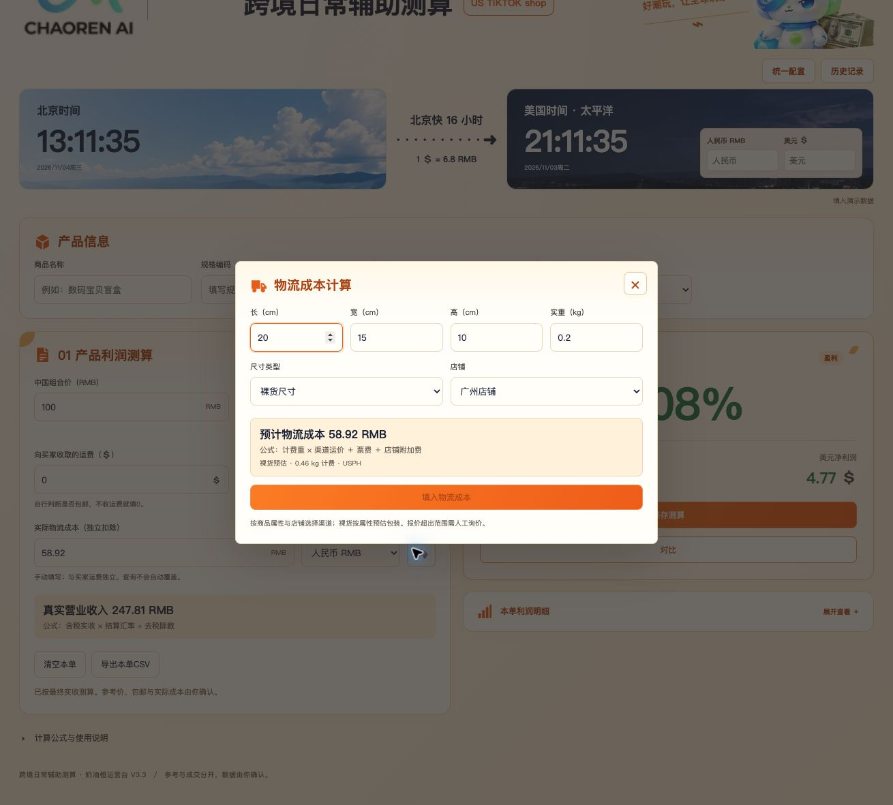

# 物流工具页面测试报告

测试日期：2026-11-04。

## 结果

在独立的 Chrome 测试标签页中，通过实际输入、切换选项、点击按钮和读取页面结果完成测试。

| 测试项目 | 数量 | 结果 |
| --- | --- | --- |
| 主页面物流工具：全部属性、包装类型、店铺、实重/体积重、重量边界、舍入、无效输入 | 256 | 全部通过 |
| 对比方案物流工具：同一套输入与预期结果 | 256 | 全部通过 |
| 配置及成本填入的报价检查 | 14 | 全部通过 |
| 统一配置的输入框 ID 和标签对应关系 | 140个输入框 | ID 全部唯一，标签全部对应正确 |
| 对比临时配置的输入框 ID 和标签对应关系 | 140个输入框 | ID 全部唯一，标签全部对应正确 |
| 物流核心现有自动测试 | 5 | 全部通过 |

526次页面报价检查的完整记录见同目录的 `物流页面测试结果.json`。有效报价检查人民币金额与按钮可用状态；无效输入或超重检查不提供报价并禁用填入按钮。D/E组额外核对渠道和计费重。

预期结果采用 `物流计算测试数据.json` 对应的数据；该数据此前已逐条执行原 HTML 单个估算处理函数，与项目默认物流计算结果核对一致。

## 配置与操作检查

- 主工具填入58.92元后，主方案物流成本为58.92元。
- 对比工具填入52.60元后，对比方案物流成本为52.60元，主方案仍为58.92元。
- 对比临时香港附加费1改为2，报价52.60变为53.60，主工具保持52.60；关闭整个对比后重新打开，恢复52.60。
- 统一香港附加费1改为2并保存，报价53.60；刷新页面后仍为53.60。
- 统一USPH第二档运价97改为100，广州普货包裹20×15×10cm、0.2kg报价从50.10变为51.00。
- 统一普货裸货尺寸系数1.15改为1，广州普货裸货20×15×10cm、0.2kg报价从58.92变为50.10；重新打开对比工具也为50.10。
- 对比临时普货尺寸系数改为1，对比工具50.10，主工具58.92；关闭整个对比后重新打开，恢复58.92。
- 从超重或无效输入改回有效输入后，报价和填入按钮恢复。
- 最后一次检查的浏览器控制台无错误。

## 发现并修复

统一配置与对比临时配置共用的输入框生成函数，把中文属性都替换为横线，导致多个输入框具有相同ID，标签可能指向其他商品属性的输入框。

已改为对完整配置键进行URI编码生成唯一ID，分别复核两处配置，每处140个输入框的ID和标签关联全部正确。页面布局、样式、运费公式和默认参数保持原样。

修改文件：`apps/web/public/legacy/freight-settings.js`。

## 测试后状态

已通过接口读取并深度比较：统一业务配置及全部物流配置与测试前完全一致，物流配置等于HTML默认配置。

测试通过当前方案的前端对比入口完成，未新增、修改或删除历史测算记录。用户原有页面的未保存输入未被操作。

## 页面截图

普货、裸货、广州，20×15×10cm、0.2kg，默认配置报价58.92元：

