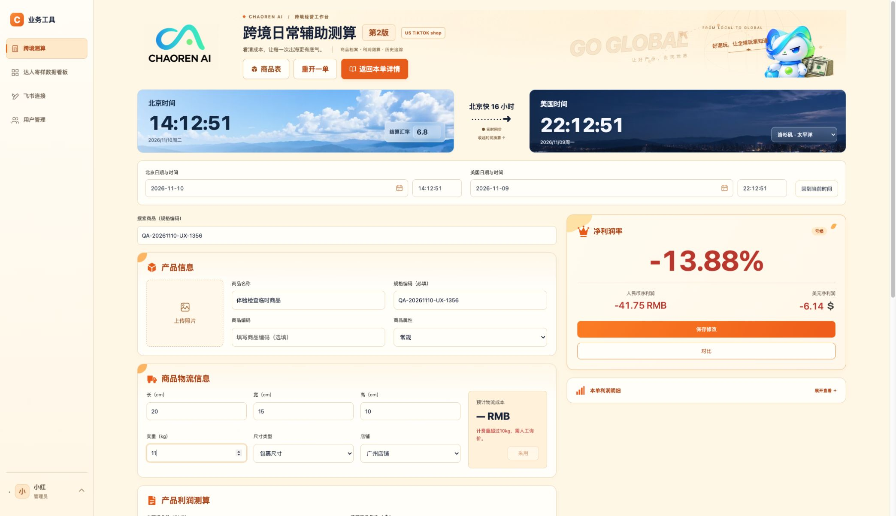

# 用户体验检查 · 2026-11-10

## 检查范围与方式

本轮检查源码、实际浏览器操作、接口集成测试及真实 Redis 测试，没有修改项目源码或业务规则。

- 管理员：使用已有的小红登录会话，检查历史、商品表、测算、对比、看板、飞书、用户管理、修改密码页面。
- 普通用户：小白首次登录、强制改密页面、业务页拦截、退出登录；没有修改小白的密码。改密后的普通用户权限、改密提交、账号重置和停用等通过隔离数据库中的集成测试验证。
- 使用本轮专建的临时商品和测试单验证保存。测试结束后已精确清理该商品、该单及其两个版本。
- 没有修改既有商品、既有测算记录、用户密码或飞书原表。

## 已实测确认的问题

### 1. 超重后，已采用的旧物流成本继续参与利润计算（优先处理）

复现：长20、宽15、高10cm、实重0.2kg、常规商品，物流估算为50.10元；点击「采用」，再把实重改为11kg。

实际表现：估算区提示「计费重超过10kg，需人工询价」，采用按钮禁用，但实际物流成本仍是50.10元，右侧仍计算出净利润-41.75元、利润率-13.88%。

影响：用户容易将已经不适用的运费当作当前运费保存。

建议：记录实际物流成本的来源。如果金额由「采用」写入，物流条件失效时应清除或明确标记失效；用户自行填写的实际成本应予以保留。

定位：`apps/web/public/legacy/app.js`，`quoteInvalid`、`updateFreightQuote`、采用按钮事件。

### 2. 对比临时参数仍进入共享商品资料（优先处理）

复现：个人默认推广费25%，在对比里改成55%，点击「接受新方案并保存」，重开一单，再搜索刚才的商品。

实际表现：重开空白单时恢复25%，证明个人默认没有被改；搜索该商品后又回填55%。数据库核对也确认本单历史和商品快照均为55%。

影响：临时参数会通过共享商品传给后续使用者，未满足「只用于本单历史」的要求。

建议：明确区分本单完整快照与商品同步内容，避免对比临时配置进入共享商品配置。个人默认的隔离目前正常。

定位：`apps/web/public/legacy/compare-ui.js` 接受方案、`apps/web/public/legacy/archive-db.js` 的 `saveProfit`、`apps/api/src/measurements.ts` 的 `syncMeasuredProduct`。

### 3. 浏览器后退可以绕过未保存提醒（优先处理）

复现：从第3版明细载入测算，修改商品名称；点击页面「返回本单详情」会提示未保存，取消后再点击浏览器后退。

实际表现：浏览器直接回到上一页，没有未保存提醒。

影响：用户习惯使用浏览器后退时，可能丢失编辑内容。代码中也没有刷新、关闭页面时的 `beforeunload` 保护。

建议：补齐浏览器级离开保护；如需应对会话到期跳转，再考虑保存本地草稿。

定位：`apps/web/public/legacy/measurement-navigation.js`。

### 4. 测算页与对比页的物流校验不一致

复现：填好物流尺寸和重量，商品属性保持未选择；完成金额测算，再打开对比。

实际表现：主测算页没有物流估算，对比页却给出50.10元的USPH报价。

影响：同一商品信息在两个入口得到不同的可报价状态；对比页实际上按默认品类处理，用户没有明确选择该品类。

建议：共用同一套缺失字段检查和报价入口，品类未选时两个页面保持一致。

定位：`apps/web/public/legacy/app.js` 的 `updateFreightQuote` 与 `compare-ui.js` 的报价逻辑。

### 5. 对比页把未保存的当前输入称为「历史」

复现：只填规格编码保存第1版，随后补填中国组合价100元、售价50美元、物流30元等信息，暂不保存，直接点「对比」。

实际表现：左侧「历史净利润率 · 原始快照」显示刚补填、尚未保存的数据；「历史保存于」显示打开对比的时间。真实第1版只有规格编码，尚无利润。

影响：用户容易误以为左侧是数据库中已保存的上一版。

建议：这个入口称为「当前方案／对比基准」，并去掉虚构的保存时间；如果要比较已保存版本，应明确载入该版快照。

定位：`archive-db.js` 的 `compare-current` 点击事件、`compare-ui.js` 的 `openComparison`。

## 界面与操作优化建议

1. **返回位置统一。** 从用户管理进入修改密码后，「返回工作台」固定回历史列表，不能回刚才的用户管理页。建议记住来源页，并在密码页沿用。
2. **时间区域统一。** 测算页与历史详情页仍存在卡片高度、结算汇率位置和辅助文字排版差异，建议统一为同一套结构和样式，再按页面需要设置紧凑模式。
3. **商品表弹窗按内容调节高度。** 只有一两条搜索结果时，下方仍有很大空白。建议保留足够的最大高度，小结果集时自动收短。
4. **趋势图分开处理金额与百分比刻度。** 当前两条线共用数值范围，金额远大于百分比时，利润率变化会被压平；净利润标注还会四舍五入成整数，和表格两位小数不完全一致。建议使用双刻度，并统一金额精度。
5. **首次改密时简化侧栏。** 目前仍展示三个业务入口，但点击后会被拦回改密页。权限拦截正确，操作体验上建议先隐藏或禁用，并注明完成改密后开放。
6. **用户管理增加资料修改入口。** 当前只有添加、重置、停用/启用；姓名填错后没有修改入口。是否允许改手机号，需要结合手机号主键规则单独确定。

## 需要核对的业务参数

初始代运营比例在代码中是 **16%**，前面明确提出过 **10%**。当前README也写明保留16%，无法从本轮检查确定是否是后续有意调整。它会直接影响净利润，修改前应先确认最终口径。

定位：`apps/web/public/legacy/core.js` 的 `FEES`；用户首次配置从这里复制。

## 代码核查发现的多人使用风险

保存接口没有提交或核对「用户载入时的版本号」。两人同时打开同一单，后保存的人可用旧表单生成新的当前版本，覆盖另一人刚修改的当前值；已有历史版本仍会保留。这一项为代码核查结果，本轮没有用两个真实用户相互覆盖验证。

建议：保存时核对来源版本；发现别人已保存时，提示重新载入或明确确认覆盖。

## 已确认正常的主要流程

| 模块 | 检查结果 |
| --- | --- |
| 登录 | 手机号格式校验、首次强制改密、退出后直接访问测算页回登录页正常 |
| 权限 | 普通用户没有用户管理入口；服务端未登录拦截、首次改密拦截、管理员权限通过隔离集成测试 |
| 新建测算 | 仅规格编码即可保存，历史与商品均新增 |
| 继续保存 | 本轮测试单由第1版追加为第2版，历史仍是一条单据，详情保留两版 |
| 商品独立修改 | 保存仅更新商品，原历史的名称和版本保持不变，历史详情也继续使用保存时名称 |
| 历史跳转 | 搜索条件能带入档案、版本明细、载入测算和返回列表 |
| 商品表返回 | 从商品表修改后能返回原商品表，并保留规格搜索条件 |
| 页面内离开 | 页面返回、侧栏跳转、重开一单的未保存提醒与取消正常 |
| 配置缺失 | 临时清空推广费时明细保留，只将缺失项及依赖结果显示为“—” |
| 个人默认 | 接受55%临时方案后，重开空白单仍使用个人默认25%；手动汇率与显式默认按钮的逻辑通过前端测试 |
| 时间 | 中美双向修改、日历中时分秒、完成、回到当前时间均可操作 |
| 看板 | 已有缓存能展示；商品搜索、多品类立即筛选、未寄出统一展开、无效数据红色明细正常 |
| 飞书读取 | 当前已连接账号能选择并完整读出二类表173条、21列；显示完整年月日 |
| 添加表格 | 可展开、取消；无效URL被表单拦截 |
| 用户管理 | 手机号格式错误不能新增；停用前有说明和取消入口，未实际停用真实用户 |

## 自动检查结果

- 登录集成检查：81项通过，使用独立临时schema。
- API测试：112项通过；最初跳过的8项Redis测试随后连接本机Redis补测通过。
- Redis专项：11项通过（包含与上项重叠的3项基础测试），验证差异更新、无变化不改记录、锁、失败保留旧缓存等。
- 前端与返回逻辑检查：50项通过。
- API、Web TypeScript类型检查：均通过。
- 真实数据库保存流程检查：通过；覆盖新单、同品新单、历史追加版本、商品独立修改、编码冲突、仅规格必填、完整版本留存等，事务回滚清理。

## 覆盖边界

- 真正修改密码、重置/停用真实用户、退出当前飞书授权、改写飞书原表均未执行；相关接口通过隔离测试验证。
- 商品照片跟随商品/历史快照及新单清除有自动测试覆盖，本轮未实际上传新照片。
- 已点击详情页导出；本轮未核对浏览器下载文件最终落盘位置。工作簿内容由已有导出测试覆盖，不能等同于人工打开Excel逐格核验。
- 看板的2条无效数据已能展开显示原记录ID与缺失原因；本轮没有逐条对照飞书原表，不能据此断言原表本身缺字段。
- 本轮主要验证桌面浏览器，没有逐个手机尺寸和所有浏览器兼容性检查。

## 清理记录

临时规格：`QA-20261110-UX-1356`。其1条商品、1条测试单、2个版本已清理并核对剩余均为0。小白首次登录测试已退出，密码未改。仅保留本报告及问题截图。
